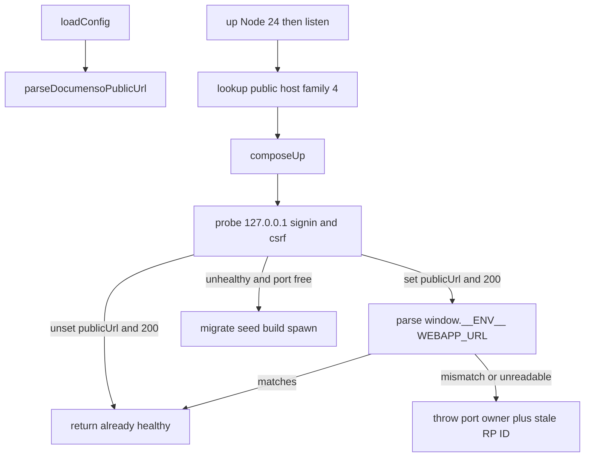

# Harness v0.2.4 Documenso public URL

## 1 Header

- Repo: `qa-portfolio-harness` · [Jayami123/qa-portfolio-harness](https://github.com/Jayami123/qa-portfolio-harness)
- Branch: `feat/2026-10-11-harness-documenso-public-url` from freshly pulled `origin/main`. Do not commit on `main`. Push the branch; **do not open a PR**.
- Base SHA **verified** this session: `353565899416474425d47faf83d32bb9ccd03762` (`Merge pull request #11`, tag `v0.2.3`).
- Start from **v0.2.3**. Target version **0.2.4**.
- Stock Documenso (no fork edits): `Jayami123/documenso` `apps/remix/server` still binds `PORT` only. RP ID is **runtime**: `getAuthenticatorOptions()` uses `new URL(NEXT_PUBLIC_WEBAPP_URL()).hostname`. `NEXT_PUBLIC_WEBAPP_URL()` reads `env()` / `window.__ENV__`. Root loader injects `window.__ENV__ = ${JSON.stringify(publicEnv)}` on `/signin`.
- Date: 2026-10-11. No ADR in this repo.

## 2 Goal and scope

WebAuthn rejects an IP as RP ID. v0.2.3 sets `NEXT_PUBLIC_WEBAPP_URL` and `NEXT_PRIVATE_INTERNAL_WEBAPP_URL` both to `DOCUMENSO_BASE_URL` (`http://127.0.0.1:3001`). Passkeys need a hostname such as `http://p1.lvh.me:3001` while the process still listens on `127.0.0.1:3001`.

**Split (decided):** `NEXT_PRIVATE_INTERNAL_WEBAPP_URL` stays the base URL (`http://127.0.0.1:3001`). Only `NEXT_PUBLIC_WEBAPP_URL` becomes `DOCUMENSO_PUBLIC_URL`. Documenso uses the internal URL when the server talks to itself; routing that through `p1.lvh.me` breaks the app whenever the name does not resolve. Passkeys only need the public URL (rpId / origin / cookie domain).

**In scope:** optional `DOCUMENSO_PUBLIC_URL`; validation; DNS check to `127.0.0.1` before compose; already-serving stale-RP-ID detection when the var is set; unit tests; README hosts/CI notes; CHANGELOG + `package.json` 0.2.4; Jayami live check on the PC after Cursor's gate.

**Out of scope:** Documenso fork changes; `HOST` bind (stock `serve({ fetch, port })` does not read `HOST`/`HOSTNAME`); killing processes; P1 Playwright wiring; merge/tag/PR.

**Compatibility:** unset `DOCUMENSO_PUBLIC_URL` (empty or omitted) = v0.2.3 env, health, already-healthy, listen.

## 3 Code reading (every base URL == public URL assumption)

Today one value (`cfg.baseUrl`) is listen URL, public URL, internal URL, health base, and `AuthSession.baseUrl`.

- `src/adapters/documenso-env.ts` `documensoListen(baseUrl)`: hostname **must** be `127.0.0.1`; port default `3001`. Unchanged. Still the listen source.
- `buildDocumensoAppEnv({ baseUrl, dbUrl })` **assumption today:** `NEXT_PUBLIC_WEBAPP_URL = NEXT_PRIVATE_INTERNAL_WEBAPP_URL = cfg.baseUrl`; `PORT` from listen. **v0.2.4 split:** extend cfg with optional `publicUrl`. When set: `NEXT_PUBLIC_WEBAPP_URL = publicUrl`; **`NEXT_PRIVATE_INTERNAL_WEBAPP_URL` stays `baseUrl`**. `PORT` still from `baseUrl`. Unset: both keys stay `baseUrl` (v0.2.3).
- `src/config.ts` `DocumensoConfig`: `baseUrl` from `DOCUMENSO_BASE_URL` only. Add optional `publicUrl?: string` from `DOCUMENSO_PUBLIC_URL` (empty → undefined, same preprocess as other optionals). Shape-validate here via a dedicated parser (not a loose `z.string().url()` only).
- `src/adapters/documenso.adapter.ts`:
  - `appEnv()` → `buildDocumensoAppEnv(this.cfg)` for migrate, seed, build, spawn. Will pick up `publicUrl` once the helper takes it.
  - `probe` / `probeBase` / `waitReady` / `health` / `waitHealthy`: always `this.cfg.baseUrl` (`127.0.0.1`). **Do not** retarget health at the public hostname.
  - `up()` already-healthy: HTTP 200 on `/signin` and `/api/auth/csrf` at `cfg.baseUrl` only. **Does not** read process env or RP ID. See §4.
  - `isPortOpen(host, port)` uses listen host/port from `documensoListen(this.cfg.baseUrl)`. Unchanged.
  - `proveAuth` / `authenticate().baseUrl`: stay `cfg.baseUrl` (API over loopback). Do not change `AuthSession`.
- `src/wait/health.ts`: generic; Documenso already sets `alternateLoopback: false`. No change.
- Logs `Documenso web is up at ${this.cfg.baseUrl}`: keep listen URL; if `publicUrl` is set, also log that advertised webapp URL.

Stock product (read-only, no edits): rpId = public hostname; cookie domain = that hostname (`getCookieDomain`); `useSecureCookies` is true when `NODE_ENV === production` **and** public URL is `https://`. Harness start already sets `NODE_ENV=production`. Local passkeys must use **http** public URL unless TLS exists. Internal URL stays loopback so server-side self-calls do not depend on `p1.lvh.me`. DNS to `127.0.0.1` is still required before `up()` so the **browser** can reach the hostname.

`NEXT_PUBLIC_*` is **runtime** here (`window.__ENV__` + `process.env`), not Vite-baked. Public URL change does **not** force a rebuild. `shouldSkipBuild()` SHA marker stays as-is.

## 4 Already serving vs stale RP ID

v0.2.3: if `/signin` + `/api/auth/csrf` are HTTP 200 on `127.0.0.1:3001`, `up()` returns and **never respawns**. The harness never kills. A server started with `NEXT_PUBLIC_WEBAPP_URL=http://127.0.0.1:3001` would be reused after the user sets `DOCUMENSO_PUBLIC_URL`, so passkeys would still see rpId `127.0.0.1`.

**Detect, do not document-only.** When `publicUrl` is set and the strict probe is healthy:

1. Reuse the `/signin` HTML (already fetched conceptually; one GET is enough).
2. Parse `window.__ENV__` JSON (the assignment before `__webpack_nonce__`).
3. Compare `NEXT_PUBLIC_WEBAPP_URL` (trailing slash stripped) to `cfg.publicUrl`.
4. Match → keep current already-healthy return (correct RP ID).
5. Mismatch, missing key, or unparseable HTML → **not** already healthy. If the listen port is open, throw the existing port-owner report **plus** the found vs expected webapp URL, and tell the user to stop that process and retry. Never kill. Never fall back to localhost.

When `publicUrl` is unset: skip `__ENV__` parse entirely (exact v0.2.3).

Pure helpers in `documenso-env.ts` so this is unit-tested with fixture HTML, no live app.

## 5 Design

**Add (all in harness)**

- `buildDocumensoAppEnv`: `NEXT_PRIVATE_INTERNAL_WEBAPP_URL` **always** `cfg.baseUrl`. `NEXT_PUBLIC_WEBAPP_URL` = `publicUrl` when set, else `cfg.baseUrl`.
- `parseDocumensoPublicUrl(raw, listenPort)`: require `http:` or `https:`; hostname present; hostname is **not** `localhost` (case-insensitive) and **not** an IP (`net.isIP`); URL port (default 80/443 if omitted) **equals** listen port; strip trailing slash. Clear errors naming `DOCUMENSO_PUBLIC_URL`.
- `assertDocumensoPublicHostResolvesToLoopback(hostname, lookup = dns.promises.lookup)`: `lookup(hostname, { family: 4 })`; require `address === "127.0.0.1"`. Inject `lookup` for tests. On failure print hosts-file instruction including `127.0.0.1 <host>`. **No localhost fallback.** Use `dns.lookup` (getaddrinfo / hosts file), not `resolve4`.
- `parseDocumensoRunningWebappUrl(html)` for the `__ENV__` check.
- `DocumensoConfig.publicUrl?: string`.
- `.env.example` commented optional `DOCUMENSO_PUBLIC_URL=http://p1.lvh.me:3001`.

**`up()` order**

1. Node 24 gate (unchanged).
2. `documensoListen(baseUrl)`.
3. If `publicUrl` set: DNS assert (**before compose**, no Docker side effects on DNS failure).
4. `composeUp`.
5. Probe; `__ENV__` gate only if public URL set.
6. Rest unchanged.

**Validate public URL at `loadConfig`** (shape) so bad env fails before `up()`. DNS only in `up()`.

## 6 Unit tests (`src/adapters/documenso-env.test.ts`)

Required:

- Unset `publicUrl`: `NEXT_PUBLIC_WEBAPP_URL` and `NEXT_PRIVATE_INTERNAL_WEBAPP_URL` stay `http://127.0.0.1:3001`; `PORT` `3001` (old env).
- Set `publicUrl` `http://p1.lvh.me:3001`: `NEXT_PUBLIC_WEBAPP_URL` equals the public URL; **`NEXT_PRIVATE_INTERNAL_WEBAPP_URL` stays `http://127.0.0.1:3001`**; `PORT` still `3001`.
- Reject `http://localhost:3001`, `http://127.0.0.1:3001`, `http://[::1]:3001`, port mismatch (`http://p1.lvh.me:3000` vs listen `3001`).

Also (same file, keep the helpers honest):

- Injected lookup: `127.0.0.1` passes; other IP / `ENOTFOUND` throw with hosts-file text.
- Fixture HTML: matching `__ENV__` vs stale `127.0.0.1` vs missing script.

Do not add live DNS tests against real `lvh.me`.

## 7 Docs and version

- `README.md` How to start Documenso: optional `DOCUMENSO_PUBLIC_URL`; listen, health, and **internal** URL stay `127.0.0.1:3001`; only the public/webapp URL (passkeys, browser) uses the hostname; stale-server stop-yourself note.
  - Windows hosts: `C:\Windows\System32\drivers\etc\hosts` line `127.0.0.1 p1.lvh.me`
  - Linux/macOS: `/etc/hosts` same line
  - CI: `echo "127.0.0.1 p1.lvh.me" | sudo tee -a /etc/hosts`
- `CHANGELOG.md` `## v0.2.4 — 2026-10-11`
- `package.json` `"version": "0.2.4"`
- `package-lock.json` root `version` is still `0.2.1` on v0.2.3; bump the two root version fields to `0.2.4` in the release commit
- Consumer GitHub pin: leave at last **existing** tag `v0.2.3` until Jayami tags `v0.2.4` (same rule as v0.2.3 vs v0.2.2)
- `.env.example` commented optional var

## 8 Files to touch

- `docs/plans/2026-10-11-harness-v0.2.4-documenso-public-url.md` (this file)
- `src/adapters/documenso-env.ts`
- `src/adapters/documenso-env.test.ts`
- `src/config.ts`
- `src/adapters/documenso.adapter.ts`
- `.env.example`
- `README.md`
- `CHANGELOG.md`
- `package.json`
- `package-lock.json`

No changes: `health.ts`, `index.ts`, `AuthSession`, Docker compose, Documenso fork.

## 9 Risks

- Stale already-healthy process (mitigated by `__ENV__` compare when public URL is set). HTML shape can change upstream; treat unreadable as mismatch, not as pass.
- `https://` public URL + production `NODE_ENV` → `__Secure-` cookies; document http for local.
- Internal URL stays `127.0.0.1:3001`, so a missing hosts entry does not break server self-talk. The browser still needs the name; DNS check before compose covers that.
- `p1.lvh.me` often already resolves via public DNS; hosts-file docs still required.
- `{ family: 4 }` ignores `::1` hosts entries; that is intended (no localhost/IPv6 fallback).
- `loadConfig` cache: tests that need config must `resetConfigCache`; prefer testing parsers directly.
- P1 must browse `http://p1.lvh.me:3001` for passkeys; this PR only documents that. `AuthSession.baseUrl` stays loopback for API probes.

## 10 Verification

This repo has no ESLint/Prettier. Mirror CI with `npm run check` (`typecheck` + `npm test` + `build`).

### Cursor hard gate (before push)

1. `npm test` (unit) passes
2. `npm run build` passes
3. `npm run check` passes

Then **push** `feat/2026-10-11-harness-documenso-public-url`. **Do not open a PR.** Cursor must not invent live numbers if the product fork is not on the VM.

### Jayami live gate (PC, after the build, Node 24)

Required. The cloud gate skipping a live run is fine; this is how we see it actually work.

Hosts file already has (or add) `127.0.0.1 p1.lvh.me`. Then:

1. **Stale-server path (do not stop Documenso first).** With a v0.2.3-style server already on `127.0.0.1:3001` (public URL still `http://127.0.0.1:3001`), set `DOCUMENSO_PUBLIC_URL=http://p1.lvh.me:3001` in the harness `.env` and run `nvm use 24` then `node scripts/up.mjs documenso`. Expect a **stale server** error (found vs expected `NEXT_PUBLIC_WEBAPP_URL`, port-owner report). Harness must not kill the process and must not treat it as healthy.
2. **Clean path.** Stop the running Documenso yourself. Keep `DOCUMENSO_PUBLIC_URL=http://p1.lvh.me:3001`. Run `node scripts/up.mjs documenso` under Node 24. Then open `http://p1.lvh.me:3001/signin` and confirm it loads.
3. Paste real command output and a note that `/signin` loaded. Do not invent results.

`NEXT_PRIVATE_INTERNAL_WEBAPP_URL` in the spawned env must remain `http://127.0.0.1:3001` on the clean run (visible in unit tests; live confirmation is the sign-in page plus a successful `up()`).

## 11 Commit plan

1. `docs(plan): harness v0.2.4 Documenso public URL`
2. `feat(documenso): add optional DOCUMENSO_PUBLIC_URL for WebAuthn RP ID`
3. `test(documenso): cover public URL env split and rejections`
4. `chore(release): v0.2.4` (package.json, lock versions, CHANGELOG, README, `.env.example`)

Each commit leaves `npm run check` green. No commit on `main`.

## 12 Will NOT do

Documenso source; HOST bind; process kill; P1 CI hosts-file step (document only); merging/tagging; opening a PR; changing health to the public hostname; setting `NEXT_PRIVATE_INTERNAL_WEBAPP_URL` to the public URL; forcing rebuild on public URL change; localhost DNS fallback.

## 13 Open questions

None blocking. `__ENV__` compare is the chosen already-serving design (detect, not document-only). Internal URL stays loopback; only the public webapp URL follows `DOCUMENSO_PUBLIC_URL`.
