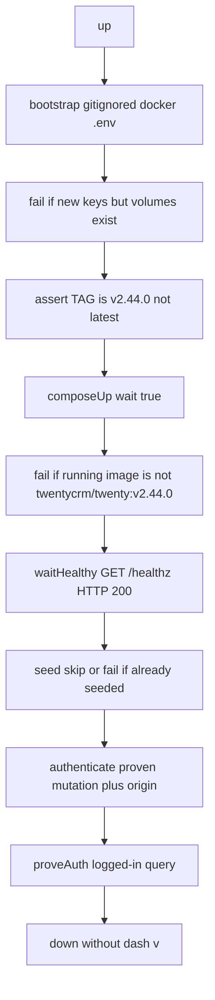

# Harness v0.2.7 Twenty adapter

## 1 Header

- Repo: `qa-portfolio-harness` · [Jayami123/qa-portfolio-harness](https://github.com/Jayami123/qa-portfolio-harness) · harness
- Branch: `feat/2026-10-13-harness-twenty-adapter` from freshly fetched `origin/main`. Do not commit on `main`. Push the branch. Do not open a PR, tag, or merge.
- Base SHA **verified** this session: `c5116b843dc534daad9777eba63be20a98b8980d` (matches `origin/main`). Start from **v0.2.6**. Target **v0.2.7**.
- Fork (read-only, never edit): `D:\Jayami\Portfolio\products\twenty-CRM` HEAD `7cbdfec6f346b43715bc2056932f4fad5886f733` (`main` = `origin/main` = `cursor/anchor-b-local-validation-probes`).
- Date: 2026-10-13. No ADR in this repo.
- Start/stop Twenty only through `node scripts/up.mjs twenty` and `node scripts/down.mjs twenty`. Reset volumes with the documented `down -v` command, not by editing the fork.

## 2 Goal and scope

The adapter exists (`src/adapters/twenty.adapter.ts`) but is below the Documenso bar: compose has no `--wait`, `health()` treats HTTP < 500 as ok, `TAG` is not pinned in the overlay so product compose can fall back to `latest`, `assertDockerEnv()` refuses to create secrets so `up()` dies without a hand-made `.env`, auth is an unverified `getLoginTokenFromCredentials` with `origin = TWENTY_BASE_URL`, `proveAuth()` is a no-op, seed documents only Limited `tim@apple.dev`, and there are no Twenty unit tests.

**In scope:** live probe through the harness with labelled evidence; pin `twentycrm/twenty:v2.44.0`; compose `--wait` plus HTTP 200 readiness; gitignored secret bootstrap with a volume/key mismatch guard; auth mutation and origin proven by the probe; Admin default user with the **seeder password** (not password-equals-email); seed role list; idempotent `seed()`; `proveAuth()`; P1 storage notes recorded not implemented; `down()` keeps volumes; unit tests; CHANGELOG, README, version 0.2.7; two live smokes (fresh volumes then kept volumes).

**Out of scope:** twenty-CRM fork edits; editing the hosts file; P1 Playwright / `storageState`; harness CI Docker; Mailpit remap unless the probe shows a clash; `down -v` as the default; merge, tag, or PR.

## 3 Seed password (read before defaults)

Fork validation README line 15 says password equals email. That conflicts with the master plan.

**Verified this session** in the local fork source (not yet against image `2.44.0`):

`D:\Jayami\Portfolio\products\twenty-CRM\packages\twenty-server\src\engine\workspace-manager\dev-seeder\core\utils\seed-users.util.ts`

Jane, Tim, Jony, Phil, and Scott all use the same `passwordHash` with the inline comment `tim@apple.dev` (lines 31–32, 42–43, 53–54, 64–65, 75–76). Insert uses `.orIgnore()` (lines 85–99).

The Docker image is `twentycrm/twenty:v2.44.0`. This source tree's `package.json` version is `0.2.1`. The running image may differ.

**Probe must re-read that file** (from the fork, and inside the server container if the image contains it) and **try login on the live 2.44.0 app** with Jane + shared password vs Jane + email-as-password. Record HTTP status, `errors[]` on HTTP 200, and which password works. Only then set `TWENTY_EMAIL` / `TWENTY_PASSWORD` defaults in `src/config.ts`.

Do not log the password. Refer to it as `TWENTY_PASSWORD`. The seeder comment is public source, not a production secret.

## 4 Live probe first (after the plan commit, before adapter code)

This session has not started Docker. Durations stay `TBD` until the probe. Every failure labelled **ENVIRONMENT** / **TEST BUG** / **PRODUCT BUG** with command, HTTP status, and body (no secrets).

If `apple.localhost` does not resolve, record **ENVIRONMENT** and **stop at that step**. Do not edit the hosts file. Jayami decides.

Sequence, through the harness only:

1. `git status` on the harness. Create `feat/2026-10-13-harness-twenty-adapter` from `origin/main`. Do not carry unrelated working-tree dirt. Commit this plan file first.
2. Read `seed-users.util.ts` again on disk and, once the container is up, from inside the image if present. Record the password comment and hash prefix only (not the full hash in chat if avoidable; the file already has it).
3. `node scripts/up.mjs twenty`. If it fails because `packages/twenty-docker/.env` is missing or `ENCRYPTION_KEY` is unset: record the exact error as **ENVIRONMENT**. That is expected today (`src/adapters/twenty.adapter.ts` 40–55). Do not hand-create secrets. Continue after the secret-bootstrap commit so the rest of the probe uses the supported path.
4. Time to `GET {TWENTY_BASE_URL}/healthz` returning **HTTP 200**. Log every status seen (connection refused, 502, 200). Try both `http://localhost:3002` and `http://127.0.0.1:3002`. **Write the winner into `src/config.ts` as the `TWENTY_BASE_URL` default**, not only into this plan.
5. `seed()` duration wall-clock on a **fresh** volume. Keep the 40 minute exec timeout unless the probe shows a different need.
6. Re-seed: run `seed()` a second time on that same volume. Record stdout/stderr, exit code, and whether rows duplicated. Then decide skip vs clear fail (section 5). User-table `.orIgnore()` in this source is **inferred**, not verified on 2.44.0.
7. Auth matrix against `/metadata` on 2.44.0. For each cell record HTTP status, `errors[]` even on HTTP 200, and `data` shape (truncate tokens):
   - `getLoginTokenFromCredentials` with `origin = TWENTY_BASE_URL`
   - `getLoginTokenFromCredentials` with `origin = http://apple.localhost:3002` (only if that name resolves; else ENVIRONMENT and stop)
   - `signIn` (fork probe, `scripts/validation/anchor-b-local-probes.ps1` 184–197) then `getAuthTokensFromLoginToken` with `workspaceUrls.subdomainUrl`
   - Jane + seeder password vs Jane + email-as-password
8. Logged-in query with the Bearer (candidate: `currentUser` / `currentWorkspaceMember`). Record the field that returns email. That becomes `proveAuth()`.
9. P1 notes only (no P1 code): base URL, workspace URL, and how the front stores tokens. Search the running app plus `packages/twenty-front` (cookie name vs `localStorage` key). Paste file:line into README when found.
10. Port clash check (`netstat` / `docker compose ps`): Cal **3000**, Documenso **3001**, Twenty overlay **3002**; Documenso Inbucket SMTP **2525** / UI **9003** (`docker/documenso.compose.yml` 31–32) vs Mailpit **8025** / **1025** (`docker/twenty.compose.yml`). Expected: no overlap. If overlap, remap in the overlay only.
11. `node scripts/down.mjs twenty` (no `-v`). Confirm volumes remain.

Fork wait budget for comparison: 10 minutes to HTTP 200 (`scripts/validation/anchor-b-up.ps1` 203–237). Product server healthcheck is `curl --fail http://localhost:3000/healthz`, interval 5s, retries 20 (~100s) (`packages/twenty-docker/docker-compose.yml` 55–59). Compose `--wait` alone may be shorter than first boot. The HTTP poll budget is sized from this probe, floor 10 minutes if the probe does not finish.

## 5 Design (industry first, then alternatives)

### Image pin

**Chosen:** overlay sets `image: twentycrm/twenty:${TAG:-v2.44.0}` on `server` and `worker` (`docker/twenty.compose.yml`). Adapter keeps passing `TAG` from `TWENTY_IMAGE_TAG` (default `v2.44.0`, `src/config.ts` 56). `up()` throws if `imageTag` is `latest` or empty. After `--wait`, inspect the running server image and throw if it is not `twentycrm/twenty:v2.44.0` (or the configured tag). Why: product compose default is `${TAG:-latest}` (`packages/twenty-docker/docker-compose.yml` 5); `.env.example` has `TAG=latest`. Compose shell env from the adapter should win, but an explicit overlay default plus inspect is the fail-fast.

**Rejected:** hardcode `twentycrm/twenty:v2.44.0` and ignore `TWENTY_IMAGE_TAG` (cannot bump without an overlay edit). Rely on adapter env only (`.env` `TAG=latest` is a footgun if someone runs compose by hand).

### Readiness

**Chosen:** `composeUp(opts, { wait: true })` like Documenso (`src/adapters/documenso.adapter.ts` 412). `health()` uses `isOk: (s) => s === 200` on `/healthz`. Override `waitHealthy()` with a budget from the probe (floor 10 min). `health()` stays a single snapshot (`timeoutMs: 0`). Default `TWENTY_BASE_URL` in `src/config.ts` is the probe winner (`localhost` vs `127.0.0.1`).

**Rejected:** keep default `status < 500` (a 502 during boot would pass). Rely on `--wait` only (healthcheck retries ~100s, fork needed 10 min).

### Secrets, including mismatch guard

**Chosen:** if `packages/twenty-docker/.env` is missing, copy `.env.example` then set `ENCRYPTION_KEY` and `APP_SECRET` with `crypto.randomBytes(32).toString("base64")`. If the file exists, fill only blank or `replace_me*` keys. Never overwrite a real key. Never log values. Never write the harness `.env`. Fork already gitignores `**/**/.env` (twenty-CRM `.gitignore` line 1).

**Mismatch guard:** before generating or replacing placeholder keys, check whether `qa-harness-twenty` volumes already exist (project `db-data` / `server-local-data`). If volumes exist and this `up()` would write a **new** key, throw and tell the operator to reset:

`docker compose -p qa-harness-twenty -f docker-compose.yml -f <harness>/docker/twenty.compose.yml down -v`

from `packages/twenty-docker`. Do not start the stack. A new key against old Postgres is a decrypt failure that looks like a product bug.

If `.env` already has real keys and volumes exist, that is a restart. Proceed.

If there are no volumes, generating keys is a first boot. Proceed.

**Why not keep refuse:** refuse is safer for a public library. This package is private, consumed from git tags, and `node scripts/up.mjs twenty` is the supported start. The fork script already generates these keys (`scripts/validation/anchor-b-up.ps1` 148–152). Generating into a gitignored product file unblocks the harness without inventing user passwords. `TWENTY_API_KEY` stays unset unless the user pastes one.

**Rejected:** call the fork PowerShell from the adapter (Windows-only, invents secrets with `Get-Random`, starts on port 3000). Commit a `.env`. Generate a new key on top of existing volumes and hope Twenty errors clearly.

### Compose overlay (no fork validation file)

**Chosen:** Only `-f docker-compose.yml` (tracked in the fork) and `-f <harness>/docker/twenty.compose.yml`. Never `-f docker-compose.validation.yml` — that overlay is optional on the fork (Anchor B), untracked in many clones, and breaks CI.

**Mailpit in harness overlay:** `axllent/mailpit:v1.22.3` on **8025** / **1025**, plus SMTP env on `server` / `worker` (`EMAIL_DRIVER=smtp`, `EMAIL_SMTP_HOST=mailpit`, etc.).

**Single workspace (`IS_MULTIWORKSPACE_ENABLED=false`):** Multi-workspace mode expects workspace login origins such as `apple.localhost:3002` (`workspaceUrls.subdomainUrl`). That needs hosts resolution Jayami may not have. Single-workspace mode keeps auth on `TWENTY_BASE_URL` (`127.0.0.1:3002`) for harness smoke without editing the hosts file. Anchor B multi-workspace probes stay on the fork validation compose, not this harness path.

**Rejected:** Require `docker-compose.validation.yml` in every clone. Rely on `IS_MULTIWORKSPACE_ENABLED=true` for harness smoke when `apple.localhost` does not resolve.

### Auth

**Chosen after the probe.** Expected mutation (fork evidence, not yet live-verified): `signIn` on `/metadata`, then `getAuthTokensFromLoginToken` with `origin` from `availableWorkspacesForSignIn[].workspaceUrls.subdomainUrl` (fallback `customUrl`, then `TWENTY_BASE_URL`).

Expected default user: Admin `jane.austen@apple.dev`. Expected password: the **shared seeder password** `TWENTY_PASSWORD` (source comment `tim@apple.dev` for every demo user). Confirm on image 2.44.0 before coding the default. Keep `TWENTY_API_KEY` as an override. Treat HTTP 200 + `errors[]` as failure. Extract parse/origin helpers so tests stay offline.

If `apple.localhost` does not resolve: **ENVIRONMENT**, stop, Jayami decides. Do not edit hosts.

If the probe shows `getLoginTokenFromCredentials` plus `TWENTY_BASE_URL` is enough, keep that mutation and drop the subdomain requirement. Do not guess.

Seed `users[]`: Admin `jane.austen@apple.dev`, Member `jony.ive@apple.dev`, Guest `phil.schiler@apple.dev`, Limited `tim@apple.dev`. Notes: one shared `TWENTY_PASSWORD` (seeder), not password-equals-email. Adapter does not invent extra users.

`AuthSession.raw` must name the real mutation and origin used.

### seed() already-seeded

**Chosen after the probe.** Required behaviour: never half-seed.

- If the second `seed()` is a clean no-op (users `.orIgnore()`, command exit 0): skip the exec when a cheap check shows Jane (or another documented seed user) already exists. Log `seed skipped: already present`. Return `created: false`.
- If the second `seed()` errors or duplicates rows: do not retry blindly. Fail with the command output and tell the operator to `down -v` for a clean seed.

Do not change the Twenty seeder. Detection lives in the adapter (SQL via the existing read-only helper is not enough if the role cannot SELECT; prefer GraphQL or a documented seed marker from the probe).

### proveAuth

**Chosen:** POST a logged-in GraphQL query (field from the probe) with `Authorization: Bearer`. Assert HTTP 200, empty `errors[]`, and email matches the session user (Jane by default). Not public `/healthz`.

### down

**Chosen:** `compose down` without `-v`. README documents reset (the same `down -v` command as the mismatch guard). Optional `TWENTY_DOWN_VOLUMES=1` only if it stays a few lines. Default stays keep-data.

Verification smokes (section 10) use an explicit `down -v` **once** before smoke 1, then keep volumes for smoke 2.

### P1 later

Record in README/CHANGELOG: `TWENTY_BASE_URL` (the `src/config.ts` default), workspace origin URL, cookie vs `localStorage` key. Do not add Playwright or `storageStatePath` wiring.

## 6 Unit tests

New `src/adapters/twenty-env.ts` + `src/adapters/twenty-env.test.ts` (same pattern as Documenso). Offline only:

- `isTwentyHealthyStatus`: 200 ok; 302/502 not ok
- Secret bootstrap with injected fs: missing file copies example and writes both keys; existing real `ENCRYPTION_KEY` not overwritten; `replace_me` replaced; generated values never appear in thrown messages
- Mismatch guard: volumes exist + would generate new key throws the reset message; volumes exist + existing real key does not throw; no volumes + generate does not throw
- Auth body parser: HTTP 200 + `errors[]` throws; HTTP 200 + token returns token; missing `data` throws
- Origin selection: `subdomainUrl` wins, then `customUrl`, then base URL
- Image tag guard: `latest` and empty throw
- Seed already-present helper: skip vs fail messages, no live Docker

No live Twenty in `npm test`.

## 7 Docs and version

- `CHANGELOG.md` `## v0.2.7 — 2026-10-13`: pin, readiness, secret bootstrap and mismatch guard, auth/proveAuth, shared seeder password, seed skip/fail, down volumes, loopback default.
- `README.md` Twenty limitations: replace the refuse-secrets line; document Admin + shared `TWENTY_PASSWORD`; HTTP 200; image pin; Mailpit ports vs Documenso 2525/9003; reset `-v`; P1 URL/storage notes from the probe.
- `.env.example`: comment Jane as the default Admin; do not fill the password; `TWENTY_IMAGE_TAG=v2.44.0`; `TWENTY_BASE_URL` matches the probe winner.
- `package.json` and both root `package-lock.json` version fields: `0.2.7`.
- Consumer GitHub pin in the README stays. Jayami tags `v0.2.7` herself.

## 8 Files to touch

- `docs/plans/2026-10-13-harness-v0.2.7-twenty-adapter.md` (this file, committed first)
- `docker/twenty.compose.yml`
- `src/adapters/twenty.adapter.ts`
- `src/adapters/twenty-env.ts` (new)
- `src/adapters/twenty-env.test.ts` (new)
- `src/config.ts` (Admin default, `TWENTY_PASSWORD` after probe, `TWENTY_BASE_URL` loopback winner)
- `README.md`, `CHANGELOG.md`, `package.json`, `package-lock.json`, `.env.example`

No changes: twenty-CRM fork, Cal/Documenso adapters, `src/wait/health.ts` defaults (Twenty passes `isOk`), system hosts file.

## 9 Risks

- First image pull and full seed (15–30 min claimed in `src/adapters/twenty.adapter.ts` 67) dominate smoke 1. Report measured times. Do not reuse that claim as a number.
- The 2.44.0 image may not match this fork source. Password and re-seed behaviour come from the live image, not only `seed-users.util.ts`.
- `apple.localhost` may not resolve. Stop. Do not edit hosts.
- Generating `ENCRYPTION_KEY` against an old volume is the decrypt trap. The mismatch guard must run before `compose up`.
- Uncommitted harness files were present at session start (`CHANGELOG.md`, `README.md`, `package.json`, `package-lock.json`). Confirm they are already in `c5116b8` before branching.

## 10 Verification (after build)

This repo has no ESLint or Prettier. Mirror CI with `npm run check`.

1. `npm test` (includes new Twenty tests)
2. `npm run build`
3. `npm run check`
4. Live smokes, labelled which is which:
   - **Smoke 1 (fresh volumes):** `down -v` first, then `npm run smoke -- twenty` (up, waitHealthy, seed, authenticate, proveAuth, SELECT 1).
   - **Smoke 2 (kept volumes):** `node scripts/down.mjs twenty` (no `-v`), then `npm run smoke -- twenty` again. Must skip or no-op seed without half-seeding.
5. Report for **each** smoke: commit SHA (`git rev-parse --short HEAD`), elapsed **image pull**, elapsed **healthy** (`/healthz` 200), elapsed **seed**. Paste both summary lines. Label ENVIRONMENT / TEST BUG / PRODUCT BUG if either fails.
6. Push `feat/2026-10-13-harness-twenty-adapter`. Do not open a PR. Do not tag.

## 11 Commit plan

1. `docs(plan): harness v0.2.7 Twenty adapter` (this file only)
2. `feat(twenty): pin v2.44.0, wait for healthz 200, bootstrap docker secrets`
3. `feat(twenty): authenticate Admin and proveAuth`
4. `test(twenty): health, secrets, auth parse, origin selection`
5. `chore(release): v0.2.7` (`package.json`, lock versions, CHANGELOG, README, `.env.example`)

Each commit leaves `npm run check` green. No commit on `main`. Auth and config defaults wait for probe evidence. Report each commit SHA in the task report.

## 12 Will not do

Fork edits. Hand-made secrets as a workaround. Editing the hosts file. P1 Playwright. Default `down -v`. Changing Cal/Documenso health defaults. Merge, tag, or PR.

## 13 Open questions

None that block coding after the probe. Auth mutation, origin, loopback winner, password on image 2.44.0, and re-seed behaviour are probe-gated. If `apple.localhost` does not resolve, stop for Jayami.
